

  <a href="https://www.pdftara.com/">
    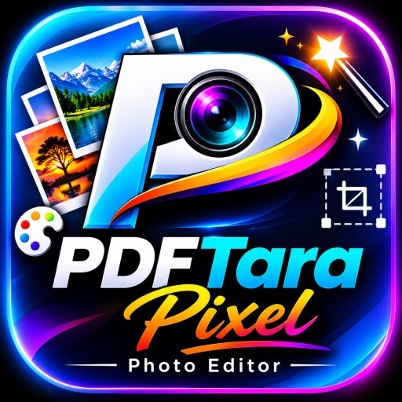
  </a>

<h1 align="center">PDFTara Pixel</h1>

  <strong>Professional Photo Editing. Creative Freedom.</strong>

  A modern, open-source photo editing application built with Rust.
  Designed for creative workflows, professional image editing and PSD documents.

  <a href="https://www.pdftara.com/">Official Website</a>

  
  
  
  
  

---

## About PDFTara Pixel

**PDFTara Pixel** is a desktop and browser-based photo editing application developed under the PDFTara brand.

Built using the Rust programming language, it aims to deliver a modern image editing experience with professional creative tools, advanced layer management and support for industry-standard image formats.

Our goal is to make professional photo editing more accessible while keeping the application open-source and focused on user control.

**Official Website:** https://www.pdftara.com/

---

## Screenshots & Interface

Explore the PDFTara Pixel interface and its image editing capabilities.

### Main Photo Editor

  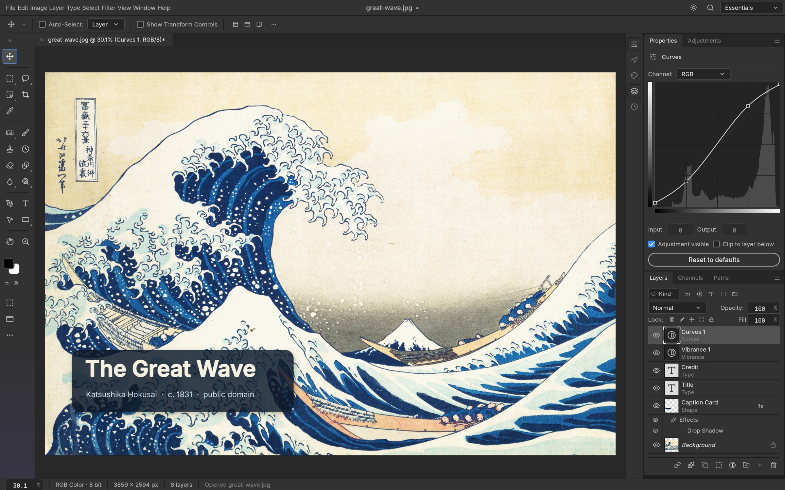

### Image Adjustments

  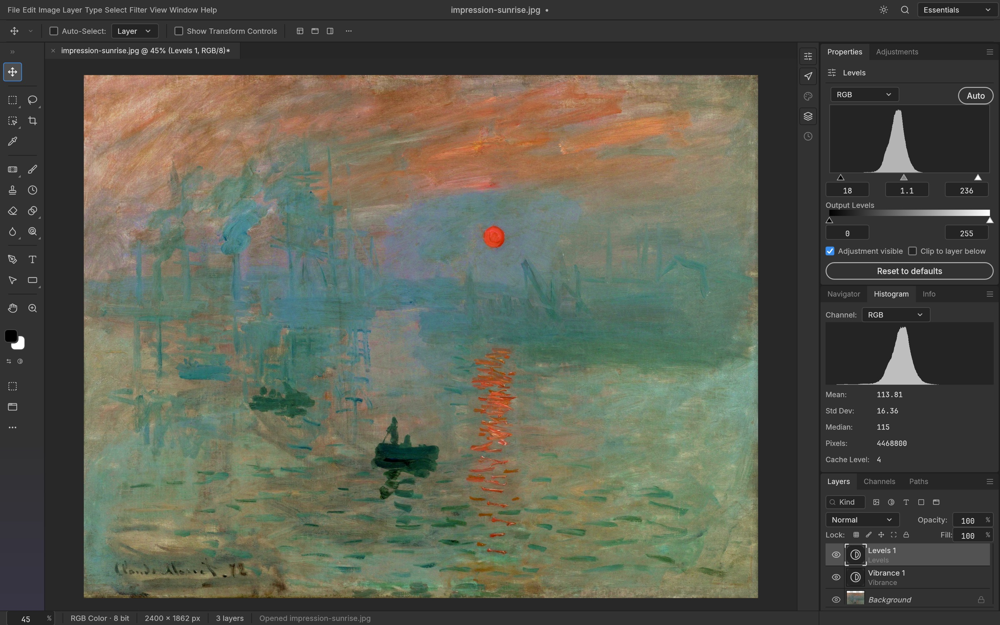

### Professional Filters

  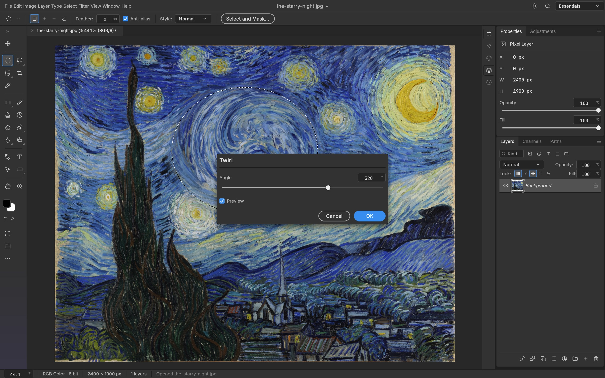

### Layer Styles

  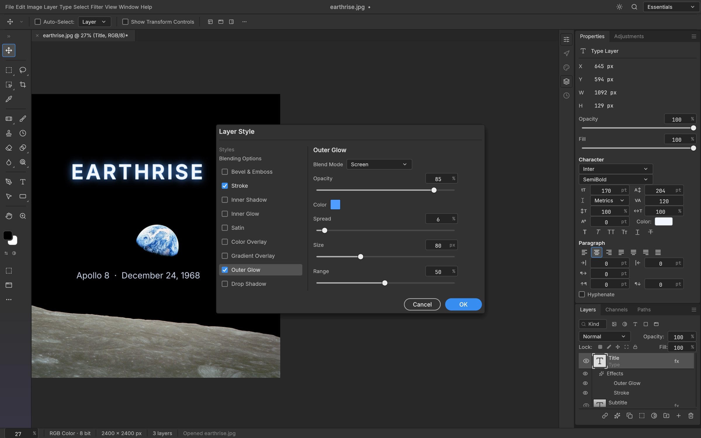

### Layer Masks

  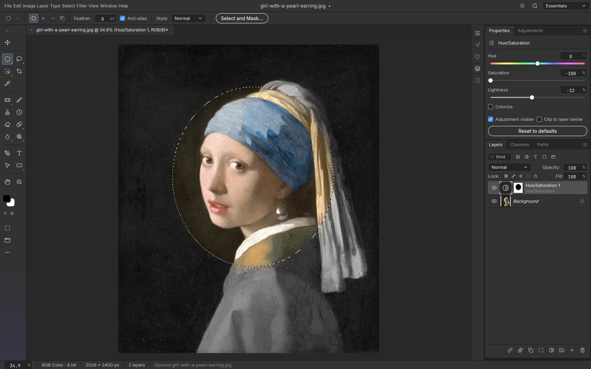

### Image Transform

  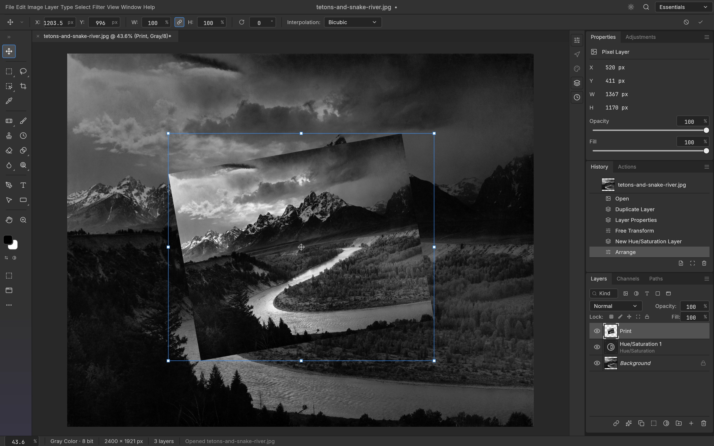

### Typography Tools

  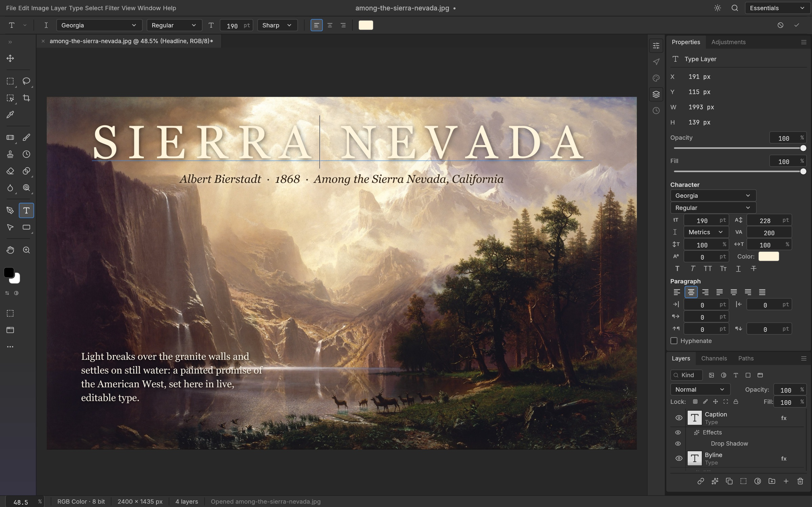

### Vector Editing

  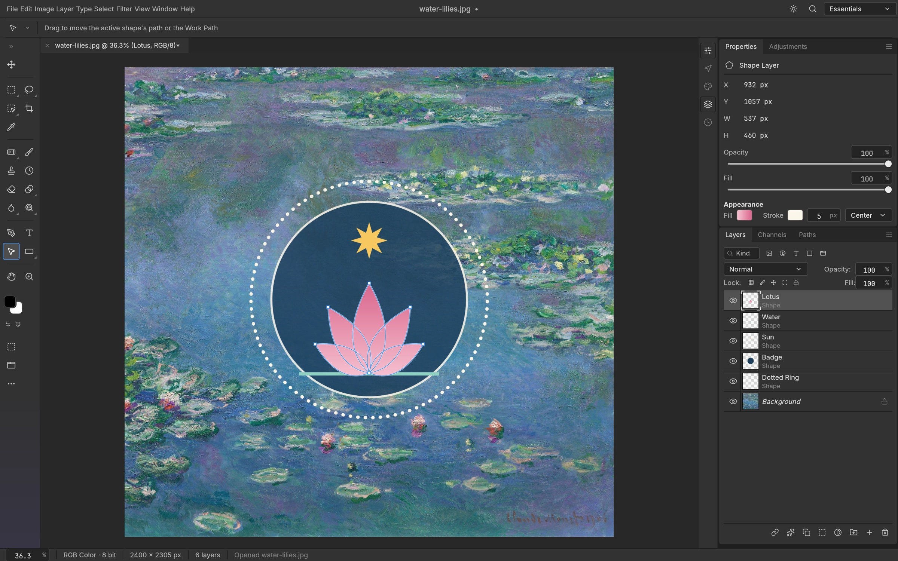

### Export Options

  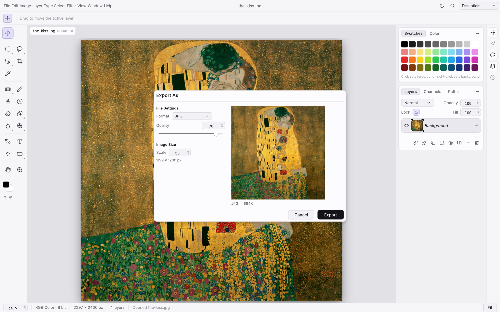

### Embedded Vector Editor

  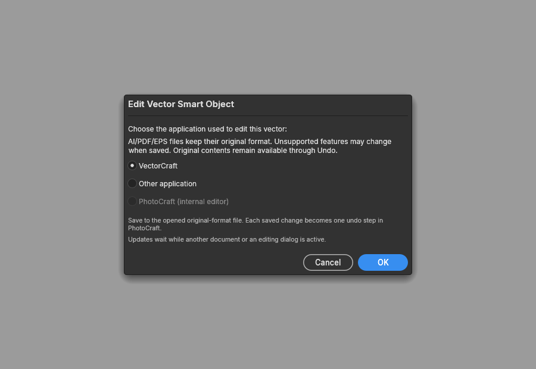

### Embedded Vector Tabs

  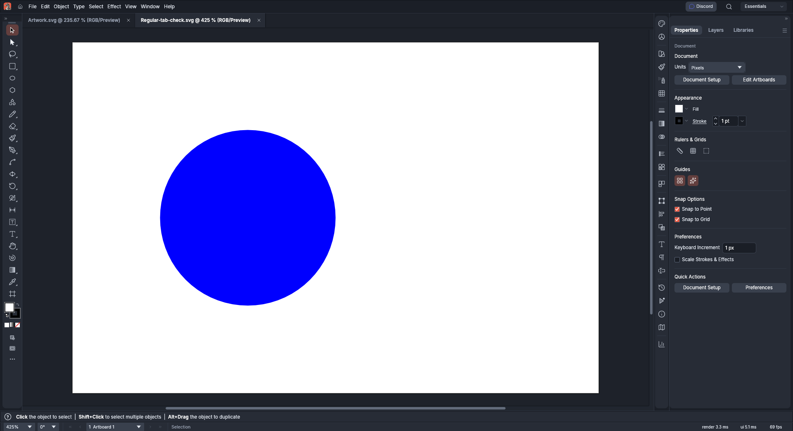

---

## Key Features

### Professional Image Editing

- Advanced image editing tools
- Layers and layer groups
- Layer masks and vector masks
- Adjustment layers
- Layer styles and effects
- Brush and painting tools
- Selection and cropping tools
- Transform and resize tools
- Typography and text editing
- Vector shapes and paths
- Color correction and adjustments
- Filters and image effects

### Advanced Layer System

- Non-destructive adjustment layers
- Layer opacity and blending modes
- Clipping masks
- Layer effects
- Group and organize layers
- Undo and history management

### Professional Color Tools

- RGB and Grayscale
- CMYK and Lab color modes
- 8-bit, 16-bit and 32-bit workflows
- ICC color management
- Curves and Levels
- Hue and Saturation
- Color Balance
- Gradient Maps
- Color Lookup

### PSD and Image Format Support

PDFTara Pixel supports a range of image and document formats, including:

- PSD and PSB
- PNG
- JPEG
- TIFF
- WebP
- GIF
- BMP
- SVG
- OpenRaster
- Additional supported image formats

Some formats and advanced features may have limitations depending on the current build.

---

## Desktop Application

PDFTara Pixel is designed as a native desktop application.

Supported platforms:

- Windows
- macOS
- Linux

The desktop application uses Rust and a GPU-accelerated rendering architecture.

---

## Browser-Based Photo Editor

PDFTara Pixel also supports browser execution through WebAssembly.

Technology:

- Rust
- WebAssembly
- WebGPU
- WebGL2 fallback
- Trunk
- Egui

The browser version is designed to run without requiring a traditional desktop installation.

---

## Technology Stack

| Technology | Purpose |
|---|---|
| Rust | Core application development |
| Egui | User interface |
| WGPU | GPU rendering |
| WebAssembly | Browser execution |
| WebGPU | Browser graphics acceleration |
| WebGL2 | Graphics fallback |
| Cargo | Rust package management |
| Trunk | Web application build |

---

## Privacy and User Control

PDFTara Pixel is designed around local-first creative workflows.

- Work with local image files.
- Keep control of your creative documents.
- No mandatory cloud-based editing workflow.
- Open-source development.
- User-controlled file handling.

---

## AI and Future Development

PDFTara Pixel's development roadmap includes exploring intelligent image editing and local AI capabilities.

Potential areas of future development include:

- AI-powered background removal
- Smart object selection
- AI image enhancement
- Intelligent image processing
- Local AI model integration

These capabilities are under development or planned and should not be considered fully available unless implemented in a released build.

Our long-term vision is to make powerful creative tools available directly on users' computers.

---

## Project Status

Early Alpha — Under Active Development

PDFTara Pixel is continuously evolving. Some features are still being improved, and certain professional workflows may have limitations.

Our focus is on improving stability, performance, compatibility and the overall editing experience.

---

## Roadmap

Our development priorities include:

- Improving the editing interface.
- Expanding professional photo editing tools.
- Improving PSD compatibility.
- Enhancing GPU performance.
- Improving typography and vector workflows.
- Expanding image format support.
- Improving Windows, macOS and Linux builds.
- Enhancing the browser-based editor.
- Exploring local AI capabilities.
- Improving stability and usability.

---

## Brand and Website

  

  <strong>PDFTara Pixel — Work Faster, Create Better.</strong>

  A creative product from PDFTara.

  <a href="https://www.pdftara.com/">
    https://www.pdftara.com/
  </a>

---

## License

PDFTara Pixel retains its applicable open-source licensing terms.

This repository includes MIT and Apache-2.0 license files. Refer to [LICENSE-MIT](LICENSE-MIT) and [LICENSE-APACHE](LICENSE-APACHE) for the applicable terms.

Third-party fonts, icons, images and bundled assets retain their respective licenses. See [ATTRIBUTION.md](ATTRIBUTION.md) and [NOTICE](NOTICE) for required notices.

---

  <strong>PDFTara Pixel</strong>
   
  A creative product from PDFTara.
    
  <a href="https://www.pdftara.com/">www.pdftara.com</a>

